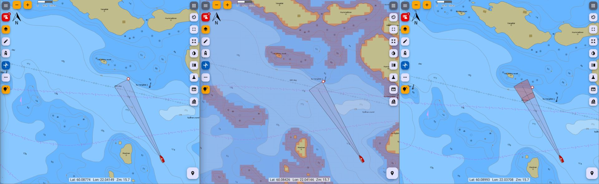
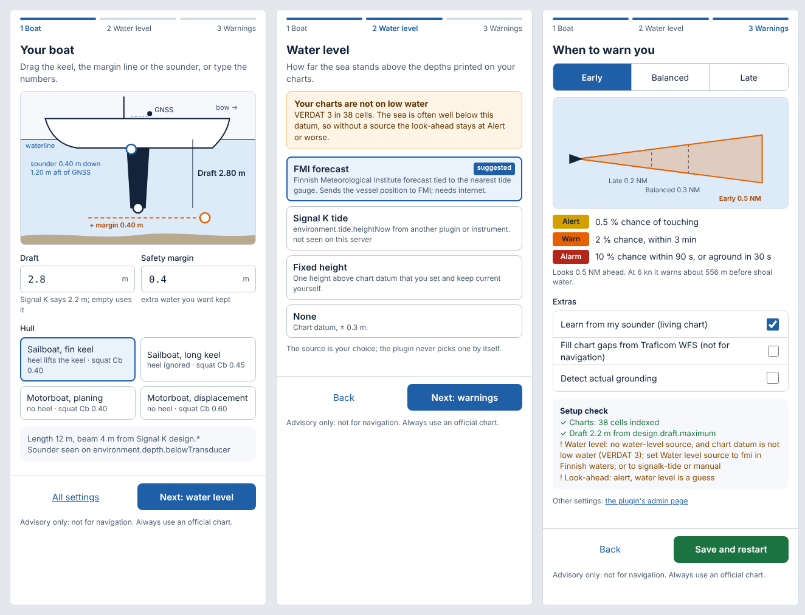
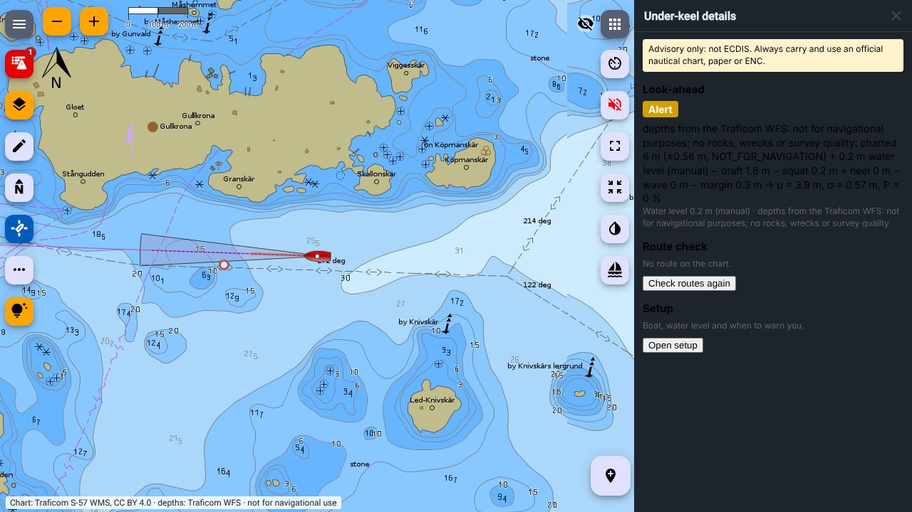
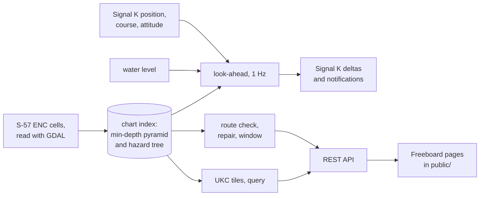

# signalk-underkeel

A [Signal K](https://signalk.org/) server plugin that warns before a boat runs into water too
shallow for its keel. It reads S-57 electronic nautical charts (ENC), combines the charted
depth and the survey quality behind it with the vessel's draft, motion and the current water
level, and publishes the risk of grounding ahead, route checks and a depth overlay for chart
plotters such as [Freeboard-SK](https://github.com/SignalK/freeboard-sk).

> Advisory navigation aid, non-commercial. Not ECDIS, and not a replacement for official
> charts or a proper lookout: always carry and use an official nautical chart, paper or ENC.

- [For users](#for-users): what the plugin does, installing it, preparing charts, settings,
  what you see, optional features, limits and troubleshooting.
- [For developers](#for-developers): architecture, repository layout, building and testing,
  the REST API and Signal K data model, contributing and releasing.
- [Documentation map](#documentation-map) and [licence](#license).



# For users

## What it does

Every second the plugin predicts where the boat will be over the next minutes, from its
position, course and speed over ground and rate of turn, as a fan of five tracks. Along each
track it lays the hull footprint, widened by the position uncertainty, and looks up the
shallowest charted depth under it. From that depth, the chart's survey quality (CATZOC), the
draft, squat, heel, a wave allowance and the water level it computes the probability that the
under-keel clearance (UKC) falls below zero, written P(UKC < 0), and sets a state:

| State     | When                                                                             | Notification                       |
| --------- | -------------------------------------------------------------------------------- | ---------------------------------- |
| `alarm`   | P ≥ 20 % within 60 s, or the mean UKC below zero within 30 s                     | `alarm`, visual and sound          |
| `warn`    | P ≥ 5 % first reached within 120 s, or part of a footprint has no chart coverage | `warn`, visual and sound           |
| `alert`   | P ≥ 1 % anywhere in the horizon                                                  | `alert`, visual                    |
| `normal`  | none of the above, with fresh position, course and speed                         | `normal`                           |
| `unknown` | no draft, no or stale position, stale course or speed, or non-finite input       | `alert`: "UKC monitoring degraded" |
| `off`     | no chart index, or the plugin is stopped                                         | `alert`, or `normal` when stopped  |

The percentages and times in the table are the Balanced warning style; Early and Late use other
values (Settings), and an expert value overrides its own. A state rises after 2 s at
its level and falls after 5 s below 80 % of its threshold, so a footprint grazing a shoal edge does
not toggle the alarm. Every notification carries the reason and the terms behind the number: the
deciding depth, its uncertainty, the water level, squat, heel and waves.

Besides the look-ahead the plugin:

- checks a planned route leg by leg at the water level expected when the boat gets there,
  suggests waypoints that route around a failing leg, and finds departure times in which every
  leg passes;
- serves a UKC overlay as vector tiles, classing chart areas `clear`, `caution`, `danger`,
  `unverified` or `land` for the current draft and water level;
- answers point and area queries for cursor readouts;
- adds its own pages to Freeboard-SK: the look-ahead envelope, route leg colours, the overlay,
  a status widget and a details panel.

It never reports `normal` on stale or missing input, never marks an unchecked route leg `ok`
and never steers the boat. The full list is under [Guarantees](#guarantees).

## Requirements

- A Signal K server on Node.js 22 or newer.
- Unencrypted S-57 ENC cells for your area. The plugin reads them with its own WebAssembly
  build of GDAL; nothing needs installing. Encrypted S-63 cells are not supported.
- The vessel's draft, set in the plugin or in Signal K `design.draft.maximum`.
- GNSS position, course and speed over ground. Heading, rate of turn, attitude (roll), speed
  through water, significant wave height and depth are used when present.
- Optional: a Freeboard-SK build with the Plotter Extensions API to see the plugin on the chart;
  internet access for the FMI water level and the Traficom WFS depths.

Reference hardware is a Raspberry Pi 4.

## Install

The plugin is not yet in the npm registry or the Signal K App Store. Build a package from this
repository and install it into the Signal K server's configuration directory (usually
`~/.signalk`):

```sh
git clone https://github.com/KEGustafsson/signalk-underkeel.git
cd signalk-underkeel
npm install
npm pack                       # builds lib/ and writes signalk-underkeel-<version>.tgz
cd ~/.signalk
npm install /path/to/signalk-underkeel/signalk-underkeel-0.1.0.tgz
```

Restart the server, then enable **Under-Keel Awareness** under _Server → Plugin Config_ in the
Signal K admin UI. Its one runtime dependency is gdal3.js (about 40 MB), which reads the S-57
cells.

**Victron Venus OS (Cerbo GX).** `package.json` asks for Node.js 22 or newer (`engines`), and CI
tests Node 22 and 24 only. Venus OS runs Signal K on the Node.js it ships, and this repository
does not record which version that is: check with `node --version` over SSH on the device before
installing. On an older Node, npm prints an `EBADENGINE` warning and installs anyway unless
`engine-strict` is set, and the plugin runs untested.

On a 1 GB machine such as a Raspberry Pi 3 or a Cerbo GX, keep the index box (the default
10 km) rather than indexing every cell, and consider **Index leaf zoom** 19. The setup check
shows the RAM and CPUs it finds and says the same; it never changes a setting.

## Prepare the charts

The plugin reads unencrypted S-57 ENC cells as they are delivered: each `.000` base cell with
its `.001`, `.002`, … updates beside it. Copy the exchange set, for example its `ENC_ROOT`
folder, under one directory and set **ENC cells directory** to it; `.000` files are found down
to three folders deep, and down to six below a folder holding the exchange set's `CATALOG.031`,
so an unzipped Inland ENC download (`<set>/ENC_ROOT/1R/7/1R7WAD07/1R7WAD07.000`) can be pointed
at as it is.

Cells downloaded with signalk-charts-provider-simple (2.16.0 or later) are read where that
plugin shares them, in its ENC store: set **ENC from Charts Provider** to one of the chart sets
or converted charts the admin form lists as shared, or to `*` for all of them. It is used
instead of **ENC cells directory**. When the charts provider writes new editions or updates of
those cells, the plugin restarts itself and rebuilds the index from them. When the collection
has no cells yet, the reason says why, as the charts provider tells it: a chart set not
downloaded or still downloading, cells being written, or no such collection. With `*` and
**Ask Charts Provider for the ENC around the vessel** on (an expert setting, off by default),
each new index box asks the charts provider to download the free ENC cells of that area, when
its **Download the ENC cells around the vessel** is on too; they arrive in its chart set
"Around the vessel" and the index is rebuilt with them. The cells are
read in place with GDAL compiled to WebAssembly
(gdal3.js), which the plugin installs with it, and the updates are applied as they are read.
Nothing is converted or written next to the cells. A cell without an `M_COVR` coverage layer
is rejected. A cell's usage band comes from the third character of its name, else from its
`DSID_INTU`, else from its compilation scale by the IHO ranges: Inland ENC cells, purpose 7 in
both, at 1:2 000 are berthing (6).

Land, shoreline and depth areas are placed by the cell's compilation scale (6 m at 1:12 000,
or inside an `M_CSCL` area that area's smaller scale) rather than by the survey's CATZOC (500 m
in zone C), so a jetty, a beach or a drying contour does not spread across navigable water;
soundings and point dangers keep the survey's CATZOC. Where the cell marks an edge or node as
not surveyed (QUAPOS) the drawing there is read as four times less accurate (24 m at 1:12 000),
and where it states a POSACC, half of it.

The index covers a box around the vessel, **Index box around the vessel (km)** (default 10 km
each way), and is rebuilt off the event loop as the vessel moves, so a large exchange set such
as NOAA's 698 East and Gulf coast cells is never indexed whole: only the cells reaching the box
are read (21 of them around Miami, 22 s at leaf zoom 20 on x86). Outside the box the plugin
reports no coverage, never clear water, and the reason says the vessel is outside the chart box
and whether it is being rebuilt; the plugin status and the details panel show the rebuild's
phase, start and the last build's duration. At speed the box grows past its radius, up to
**Largest index box at speed** (0 sizes it from the RAM), so the vessel cannot reach the edge
before the next box is built (docs/HOW-IT-WORKS.md §12). A radius under 2 km is raised to 2.
Until the first position arrives the engine is `off`
with the reason `waiting for the vessel position to build the chart box`. Set the box to 0 to
index every cell.

At the first start the plugin builds a chart index from the cells in a child process and saves
it under the plugin data directory, `~/.signalk/plugin-config-data/signalk-underkeel/index`
unless **Chart index directory** says otherwise. Until the index is ready the engine is `off`
with the reason `building chart index`. The 12 NOAA cells around Miami (6.8 MB of `.000` and
updates) build in 19 s at leaf zoom 18 on x86. Later starts load the saved index, 0.1 s for
those cells, and rebuild it when a cell was added or removed, or a cell's `.000` or update files
changed; `GET /status` names the cells that caused the rebuild. **Rebuild index at start**
forces a rebuild on every start. A cell folder may be a symbolic link. What the build read
from each cell is kept, compressed, in `cell-cache` in the plugin data directory (at most 512 MB), so a
chart box refresh reads again only the cells whose files changed: the 10 km Waddenzee box
rebuilds in 12–15 s instead of 30–34 s on x86. Deleting the folder is safe; the cells are then
read again.

Folders of GeoJSON layers exported by `scripts/enc-to-geojson.sh` for earlier versions are no
longer read: point **ENC cells directory** at the original `.000` cells instead. Such a folder
named like a cell is listed in `GET /status` as skipped.

## Settings

There are two places to set the plugin up, and both write the same configuration:

- **Open setup** at the bottom of Freeboard's _Under-keel details_ panel (toolbar button with the
  boat icon), or `/plotterext/signalk-underkeel/setup.html` in a browser: three steps, boat, water
  level and warnings, in the same panel with a link back to the details. Drag the keel, the margin
  line and the sounder on a side view of the hull, or type the numbers. The page shows the draft
  Signal K already states, the vertical datum of your charts with the water-level source that fits
  it, and a setup check, which also lists the machine's RAM and CPUs with advice on the index
  settings. **Save and restart** needs a Signal K admin login.
- The plugin's page in the admin UI. It asks for the same essentials first; **Show expert
  settings** opens the rest, and an optional feature's fields appear once it is enabled. Admin
  UIs older than Signal K 2.32 show every field at once.



| Setting                  | What it does                                                                                                                                                                 |
| ------------------------ | ---------------------------------------------------------------------------------------------------------------------------------------------------------------------------- |
| ENC cells directory      | where the `.000` cells are                                                                                                                                                   |
| ENC from Charts Provider | or a chart set or converted chart whose cells signalk-charts-provider-simple shares, `*` for all of them; used instead of the directory                                      |
| Boat                     | draft (empty uses Signal K `design.draft.maximum`) and safety margin under the keel (0 m); only the keel's lowest point counts, and squat and waves are added on top (below) |
| Water level              | source (`none`, `manual`, `signalk-tide`, `fmi`, see below); only the chosen source's fields are shown                                                                       |
| Warnings                 | Early, Balanced or Late, in the table below                                                                                                                                  |
| Optional features        | living chart (own soundings), Traficom WFS depths, grounding detector; each off until enabled                                                                                |

| Warning style      | Looks ahead | Alert at | Warn at, within | Alarm at, within | Alarm on negative mean UKC |
| ------------------ | ----------- | -------- | --------------- | ---------------- | -------------------------- |
| Early              | 0.5 NM      | 0.5 %    | 2 %, 180 s      | 10 %, 90 s       | within 30 s                |
| Balanced (default) | 0.3 NM      | 1 %      | 5 %, 120 s      | 20 %, 60 s       | within 30 s                |
| Late               | 0.2 NM      | 2 %      | 10 %, 90 s      | 30 %, 45 s       | within 30 s                |

Early is at least as cautious as Balanced in every column, and Balanced as Late.

The boat is its keel's lowest point, the draft, plus the safety margin. Two corrections that
only add depth are applied on top. **Squat**: a hull under way sits deeper in the water, by
Cb × V² / 100 m at V knots (Barrass), where Cb, the block coefficient, says how full the hull is
below the water; at the default 0.40 that is 14 cm at 6 kn and nothing when stopped. A planing
boat rises at planing speed, but its drive or propeller stays the deepest point and it squats
most just before planing, so no lift is subtracted. **Waves**: 0.4 × the significant wave
height, when Signal K has `environment.water.waves.significantHeight`.

**Heel** gives no credit: a boat leaning over lifts its keel tip, but a tack, a bear-away or
dropping the sails puts the keel back at full depth within the look-ahead, so the keel counts at
full depth. Under expert settings, **Heel effect on draft** can credit a fin keel, draft ×
(1 − cos heel) at the least roll of the last 10 s, or a table of heel to draft change.

Expert settings, with their defaults:

| Group        | Settings                                                                                                                                                                                                                               |
| ------------ | -------------------------------------------------------------------------------------------------------------------------------------------------------------------------------------------------------------------------------------- |
| Chart index  | index directory, rebuild at start, index leaf zoom (20), box around the vessel (10 km), ask Charts Provider for the ENC around the vessel                                                                                              |
| Boat         | length, beam (fallback: Signal K `design.*`); draft σ (0.05 m); block coefficient and heel effect (none, fin keel or a table); double squat in narrow channels; wave allowance factor (0.4 × Hs)                                       |
| Look-ahead   | minimum horizon (60 s); position buffer (10 m, 2σ); fan spread (COG 5°, rate of turn 0.1°/s); escape-heading rate of turn (3°/s); and the distance, probabilities and windows of the warning style, each overriding the style when set |
| Water level  | manual height and σ; FMI refresh (600 s); chart-datum mappings for FMI                                                                                                                                                                 |
| Route check  | planning speed (2.5 m/s), cross-track limit (30 m), accepted P(UKC < 0) (1 %)                                                                                                                                                          |
| Living chart | depth path and transducer offsets; Signal K notes for suspected shoals; CSB export metadata                                                                                                                                            |
| Other        | mooring zones (Signal K region ids); grounding detector acceleration path and threshold (2 m/s²); Traficom WFS survey quality (B) and box half-width (10 km)                                                                           |

The saved configuration carries a version, `configVersion`. At the first start after an update
from a configuration without one, the plugin keeps a copy as `config-v1.json` in its data
directory, removes the look-ahead values the old admin form had filled in with their
defaults, so the warning style can set them, and saves the result. The plugin then
behaves exactly as before; a value that differed from its default stays and overrides the
style.

## Water level

The chart gives depths below chart datum; the water level is how far the sea stands above it.

- `none`: chart datum, with σ 0.3 m for the unknown tide. Low-water datums include the Inland
  ENC low-water references (VERDAT 31, 36, 38) and approximate LAT (42, Rijkswaterstaat's
  Waddenzee cells). On a chart whose datum is not a
  low-water datum, such as the Finnish mean-water ENCs (VERDAT 3, 19 and 26), this is a degraded
  level: the state is at best `alert`, route legs at best `unverified`, nothing `clear`, and
  acknowledgements and own soundings are not used until a source is configured. The reason names
  the source to set: `fmi` in Finnish waters, otherwise `signalk-tide` or `manual`.
- `manual`: a fixed height above chart datum with its σ.
- `signalk-tide`: `environment.tide.heightNow` for 5 minutes after each reading, then the
  lower of it and `heightLow` until 6 h past `timeLow`.
- `fmi`: the Finnish Meteorological Institute sea-level forecast at the vessel, anchored to the
  nearest tide gauge. FMI reports above theoretical mean water and above N2000. S-57 vertical
  datum codes 3, 19 and 26 map to mean water by default; cells on N2000 need an entry under
  _Chart datum mappings_. An unmapped datum widens σ to 0.5 m. The forecast applies within 30 km
  of the point it was fetched for, near the vessel; a UKC tile or query area reaching farther
  takes the lower of the forecast and the fallback below, and shows no clear water.

A source that stops updating falls back to chart datum, or to its last level when that was
lower, with a wider σ. While the level is a fallback the state is at least `alert` with the
reason, and route legs are `unverified`.

## What you see

### In Freeboard-SK

The plugin registers a `plotterExtensions` resource, so a Freeboard-SK build with the Plotter
Extensions API shows it without any change to Freeboard:

| Where in Freeboard              | What the plugin adds                                                                                                                       |
| ------------------------------- | ------------------------------------------------------------------------------------------------------------------------------------------ |
| Layers → Charts → Plugin layers | Under-keel look-ahead (on), Under-keel route check (on), Under-keel risk (off)                                                             |
| Widget grid                     | Under-keel status: state colour, minimum clearance, time to shoal and the reason                                                           |
| Toolbar button (boat icon)      | details panel: state, water level and source, a leg table per route, and **Open setup** for boat, water level and warning style (Settings) |

Routes shown on the chart are checked 1 s after each edit and every minute; the panel shows
each result's age and marks it "out of date" after 3 minutes, when the chart draws its legs
`unverified`. Stale status is shown as Unknown,
never as the last green state. [How it works §13](docs/HOW-IT-WORKS.md#13-in-freeboard) has
screenshots, including the plugin layers in the chart list and the setup steps in the panel.



### In Signal K

| Path                                         | Content                                                                                         |
| -------------------------------------------- | ----------------------------------------------------------------------------------------------- |
| `navigation.underKeel.state`                 | `normal`, `alert`, `warn`, `alarm`, `unknown` or `off`                                          |
| `navigation.underKeel.clearance`             | predicted minimum UKC (m), and `.clearanceSigma` its σ                                          |
| `navigation.underKeel.risk`                  | highest P(UKC < 0) over the horizon                                                             |
| `navigation.underKeel.timeToShoal`           | seconds until the deciding footprint                                                            |
| `navigation.underKeel.escapeHeading`         | the heading with the longest time to shoal, when not `normal` (rad)                             |
| `navigation.underKeel.waterLevel`            | the level applied above chart datum (m)                                                         |
| `navigation.underKeel.envelopeRev`           | revision of the look-ahead geometry served at `GET /envelope`                                   |
| `notifications.navigation.underKeel`         | the state as a notification, with the reason and the explanation                                |
| `notifications.navigation.positionIntegrity` | `warn` when GNSS and dead reckoning disagree, the fix is not a satellite fix, or HDOP exceeds 4 |
| `notifications.grounding`                    | only from the optional grounding detector, when the boat has gone aground                       |

Any Signal K app can show these; the status line on the plugin's admin page reads, for
example, `Monitoring: unknown — position stale`. Each value is sent when it changes; `state` and
`envelopeRev` at least every 5 s, the others every 10 s. A display that shows them should read a
`state` older than 15 s as unknown, as the plugin's own widget does.

## Optional features

- **Acknowledged passages.** A known shallow but passable spot can be acknowledged with
  `POST /acks`. Inside its polygon, heading within ±20°, water level at most 5 cm lower and draft
  no deeper than when acknowledged, `warn` and `alarm` are published as `alert` with the reason
  "acknowledged passage". A fallback water level honours none.
- **Mooring zones.** Inside a listed Signal K region, `warn` and `alarm` are published as
  `alert` with the zone named.
- **Living chart** (off by default). Depth readings that pass a quality gate (good fix, HDOP
  under 2, small roll, a real water level) are reduced to chart datum per ~76 m cell. After five
  readings on two passes 10 minutes apart put a cell more than 2σ shallower than charted, the
  cell is lowered for every check and a Signal K note marks it. Own soundings never make a cell
  deeper. `GET /livechart/csb.geojson` exports them in the IHO crowd-sourced bathymetry format
  for you to submit; the plugin uploads nothing.
- **Grounding detector** (off by default). A sudden stop in water as shallow as the keel raises
  `notifications.grounding`.
- **Traficom WFS depths** (off by default, needs internet). Depth areas and soundings from
  Traficom's INSPIRE WFS for a box around the vessel fill gaps between ENC cells in Finnish
  waters. The data is licensed **not for navigational purposes** and has no rocks, wrecks or
  survey quality: water only it covers is at most `alert`, never `ok` in a route check and never
  `clear` on the overlay.

## Guarantees

- Stale position, a missing draft, a missing index, missing chart coverage or a fallback water
  level never give `normal`; each gives `unknown`, `off`, `warn` or `alert` with a reason.
- A route leg without chart coverage or with unassessed survey quality is `unverified`, never
  `ok`.
- The plugin never sends autopilot or steering commands.
- Only the optional grounding detector writes `notifications.grounding`.
- An acknowledged passage or a mooring zone never turns a warning into `normal`.
- A suggested route repair never moves an existing route point and never routes through
  unchecked water.

## Known limits

- The index resolves about 19 m at 60° N, and an index leaf that touches land counts as land,
  so up to one leaf width of water along a shore reads as land or danger.
- The look-ahead follows course and rate of turn, not the route: in a winding fairway it sees
  the shore ahead before each bend until the boat turns.
- Poor surveys widen hazards a lot: a CATZOC C sounding blocks a disc 1 km across.
- The UKC overlay does not look across the ±180° meridian, and wave height alone does not
  refresh it.
- No land-uplift correction is applied to old charts on mean-water datums.

[How it works §15](docs/HOW-IT-WORKS.md#15-known-limits) has the full list.

## Troubleshooting

`GET /plugins/signalk-underkeel/v1/status` on the server (for example
`http://localhost:3000/plugins/signalk-underkeel/v1/status`) reports the engine state, the
chart index and its cell editions, the look-ahead summary, the water-level source and the
datum mapping. Absolute paths in its reasons, in 5xx replies and in notification messages show
as `<path>` (an S-57 cell file keeps its name); the plugin status line and the server log keep
them whole.

| Reason shown                                                  | Cause and fix                                                          |
| ------------------------------------------------------------- | ---------------------------------------------------------------------- |
| `vessel draft not configured`                                 | set **Draft** under Boat, or `design.draft.maximum` in Signal K        |
| `position stale`                                              | no recent `navigation.position`; check the GNSS source                 |
| `course or speed stale: only the current position is checked` | no recent COG or SOG                                                   |
| `no chart index loaded`                                       | set the cells directory; an index error is shown as the plugin's error |
| `no chart coverage`                                           | the boat or its footprints are outside every ENC cell                  |

# For developers

## Architecture



The index is a min-depth pyramid over Web Mercator tiles: each node stores the shallowest
charted depth under it, the survey's position σ and coverage flags, so "how shallow is it
anywhere under this polygon" costs a few node visits. Point hazards (rocks, wrecks,
obstructions) sit in an R-tree. Every question the plugin answers, from the 1 Hz look-ahead
to a map tile, is that query against a different polygon. The design, risk model and budgets
are in the [development plan](docs/DEVELOPMENT-PLAN.md).

Source modules are layered, lowest first; a module imports only its own layer or a lower one,
and ESLint (`no-restricted-imports`) enforces it:

| Layer      | Directory         | Responsibility                                                 |
| ---------- | ----------------- | -------------------------------------------------------------- |
| foundation | `src/foundation/` | shared types, Signal K paths, geodesy and geometry             |
| ingest     | `src/ingest/`     | S-57 reading with GDAL, coverage mosaic, vertical datums, WFS  |
| spatial    | `src/spatial/`    | min-depth pyramid, hazard R-tree, index storage, build worker  |
| model      | `src/model/`      | vessel, water level providers, uncertainty, position integrity |
| engine     | `src/engine/`     | look-ahead, hysteresis, route check, repair, departure window  |
| livechart  | `src/livechart/`  | own soundings, posterior, discrepancy notes, CSB export        |
| api        | `src/api/`        | REST routes, request parsers, vector tiles, manifest           |
| entry      | `src/*.ts`        | plugin lifecycle, configuration, services and wiring           |

## Repository layout

| Path                         | Content                                                                                        |
| ---------------------------- | ---------------------------------------------------------------------------------------------- |
| `src/`                       | the plugin, in TypeScript                                                                      |
| `lib/`                       | compiled output of `npm run build`; never edited, not in git                                   |
| `public/`                    | Freeboard pages: background runtime, status widget, details panel, setup steps, shared helpers |
| `schemas/navigation-safety/` | JSON Schemas of the provider-neutral navigation-safety contract (Apache-2.0)                   |
| `scripts/`                   | synthetic fixture generator, bus vendoring, release and audit checks                           |
| `fixtures/enc/`              | small synthetic cells used by the tests                                                        |
| `fixtures/s57/`              | the same synthetic cells as S-57 `.000` files, and the script that writes them                 |
| `__tests__/`                 | Jest tests, property tests, contract tests and benchmarks                                      |
| `docs/`                      | user guide, development plan, release checklist, RFC drafts                                    |

## Build and test

Node.js 22 or newer.

```sh
npm install
npm run build             # tsc → lib/, and vendors the Plotter Extensions bus client into public/
npm test                  # Jest, hermetic, no network
npm run verify            # type-check src and tests, lint, test
npm run verify:ci-local   # what CI gates: also format check, build, coverage and the release check
npm run bench             # pyramid build and query cost on a synthetic archipelago
```

`npm test` must stay hermetic and under 120 s, since the Signal K plugin registry runs it with
no network. The compiled-worker tests need `lib/`, so run `npm run build` first. A pre-commit
hook formats and lints staged files.

Tests are behaviour tests under `__tests__/`, mirroring `src/`. Property tests use fast-check;
the conservative-depth query, monotonic risk, heel and the coverage mosaic have them. Contract
tests check the REST responses and request parsers against the schemas in
`schemas/navigation-safety/`. `scripts/make-synthetic-enc.js` regenerates the GeoJSON fixtures
in `fixtures/enc/`, and `fixtures/s57/generate.js` writes the same scenario as S-57 cells from
them. Real chart data and built indexes stay under `data/`; git ignores it, and `*.000` and
`*.fgb` files outside `fixtures/s57/`.

To run a working copy in a local Signal K server, build it and install the folder, which npm
links instead of copying:

```sh
npm run build
cd ~/.signalk && npm install /path/to/signalk-underkeel
```

Rebuild and restart the server after each change.

## REST API

Base path `/plugins/signalk-underkeel/v1`. Reads are open to readonly users; adding and deleting
acknowledgements needs a readwrite user, and the settings routes an admin. Errors are
`{ "errors": [string, …] }`; a 5xx error names no file path and no nested error text, which the
server log keeps.

| Route                                         | Purpose                                                                                                                                                                                                                                                                                              |
| --------------------------------------------- | ---------------------------------------------------------------------------------------------------------------------------------------------------------------------------------------------------------------------------------------------------------------------------------------------------- |
| `GET /status`                                 | engine state, index and cell editions, look-ahead summary, water-level health, datum mapping                                                                                                                                                                                                         |
| `GET /status?summary`                         | the same without the per-cell lists (`index.cells`, `waterLevel.datums`), for frequent polls                                                                                                                                                                                                         |
| `GET /envelope?rev=`                          | the look-ahead as GeoJSON; 304 when the client already has that revision                                                                                                                                                                                                                             |
| `POST /route-check`                           | each leg `ok`, `marginal`, `fail` or `unverified`, with P(UKC < 0), explanation and cell editions                                                                                                                                                                                                    |
| `POST /route-repair`                          | waypoints to insert around failing legs, and the whole route re-checked with them                                                                                                                                                                                                                    |
| `POST /departure-window`                      | departure intervals within `horizon` in which every leg is `ok`                                                                                                                                                                                                                                      |
| `POST /query`                                 | class, P(UKC < 0), deciding hazard and explanation for a Point or Polygon                                                                                                                                                                                                                            |
| `GET /acks`, `POST /acks`, `DELETE /acks/:id` | acknowledged passages; `POST` needs `Content-Type: application/json` or another `+json` type (415 otherwise) and a polygon of at most 64 vertices, and answers 409 while the water level is a fallback or 100 acknowledgements are live                                                              |
| `GET /livechart/discrepancies`                | living-chart cells shallower than charted; `pending: true` while a cell's chart is not read yet                                                                                                                                                                                                      |
| `GET /livechart/csb.geojson`                  | own soundings in the IHO CSB format                                                                                                                                                                                                                                                                  |
| `GET /tiles/ukc/{z}/{x}/{y}.pbf`              | Mapbox vector tiles from zoom 11, one `ukc` layer, `Cache-Control: no-cache`, gzipped on request                                                                                                                                                                                                     |
| `GET /settings`, `POST /settings`             | admin only: the configuration, what the plugin sees (`design.*`, depth paths, chart datums) and the setup check; `POST` takes a patch (`null` removes a field) with `Content-Type: application/json`, checks it against the schema (400 naming each bad field) and restarts the plugin with it (202) |
| `GET /tiles/ukc/changes?epoch=&rev=`          | the tiles served since that cursor whose classes changed, or `all`; a new cursor                                                                                                                                                                                                                     |
| `GET /ukc-style.json`                         | a MapLibre style for the tiles                                                                                                                                                                                                                                                                       |

A route-check body carries `route` (a GeoJSON LineString) or `routeRef`
(`/resources/routes/<id>`), and optionally `departure` (ISO 8601), `speed` (m/s: one value,
one per leg, `{ "default": … }` or `{ "legs": […] }`), `xteLimit` (m), `probability` and
`vessel.draft` (m). Each leg is checked over a corridor of the cross-track limit plus a
planning buffer at the lowest water level expected while on it. The request and response
schemas are in [`schemas/navigation-safety/`](schemas/navigation-safety/README.md), which also
lists the size limits that can refuse a valid request (for example route length times corridor
width at most 200 km²). Route checks, repairs, departure windows and queries run one at a time
with at most four more waiting; beyond that a request gets 503 with `Retry-After`, and a request
whose client disconnects, or that is running when the plugin stops, is abandoned between two of
its steps.

## Plotter Extensions

`src/api/manifest.ts` registers the `plotterExtensions` resource: three data overlays (the
look-ahead envelope, route-check leg colours and the UKC tiles), the status widget, the details
panel with its toolbar button, a hidden background page and the experimental
`navigationSafety` service. The pages are plain browser modules in `public/`, served from
`/plotterext/signalk-underkeel/`:

- `runtime.js`, the background page, keeps the envelope, route results and tiles current;
- `widget.js` and `panel.js` render the status and the route legs;
- `ukc-shared.js` holds their pure logic (freshness, badges, labels), the part the Jest tests
  cover.

The pages talk to the host through the vendored `signalk-plotterext-bus` client, copied into
`public/vendor/` by the build. The [Plotter Extensions services RFC](docs/rfcs/plotter-extensions-services.md)
proposes the `services` field the manifest uses.

## Contributing

[AGENTS.md](AGENTS.md) is the contributor guide for people and AI agents: the layering rules,
coding guidelines, validation per change area and pull-request expectations. Its seven safety
invariants hold in every change; a change that weakens one needs a recorded decision in the
development plan first:

1. A spatial query never returns a depth deeper than any source feature under the polygon plus
   its position-uncertainty buffer.
2. A deeper draft, a lower water level or a larger position uncertainty never lowers
   P(UKC < 0).
3. Stale or missing input never produces `normal`.
4. Route legs without coverage or with unassessed survey quality are `unverified`, never `ok`.
5. Own soundings may make a cell shallower, never deeper.
6. The plugin never sends autopilot or steering commands.
7. `notifications.grounding` means aground; look-ahead warnings use
   `notifications.navigation.underKeel`.

Commits and pull-request titles follow `type(scope): subject`. CI runs lint, type checks,
format, coverage, the build, a shipped-dependency audit and the Signal K plugin CI matrix
(Linux, macOS, Windows, arm64 and a Signal K server integration run).

## Releasing

Versions and releases are the maintainer's. [docs/release-checklist.md](docs/release-checklist.md)
lists the commands; `npm publish` runs a release check that refuses an undated changelog
heading. [CHANGELOG.md](CHANGELOG.md) records user-visible changes.

## Documentation map

- [How it works](docs/HOW-IT-WORKS.md): the plugin step by step for users, with flowcharts and
  screenshots.
- [Development plan](docs/DEVELOPMENT-PLAN.md): architecture, risk model, APIs, Freeboard
  integration, performance budgets and milestones.
- [Release checklist](docs/release-checklist.md): commands to run before publishing.
- [Navigation-safety schemas](schemas/navigation-safety/README.md): the provider-neutral
  contract and its limits.
- RFC drafts: [`navigation.underKeel.*` paths](docs/rfcs/signalk-navigation-underkeel.md),
  [Plotter Extensions `services`](docs/rfcs/plotter-extensions-services.md) and
  [crowdsourced depth cells](docs/rfcs/crowdsourced-depth-cells.md).
- [AGENTS.md](AGENTS.md): contributor and AI-agent guide.

## License

Copyright (c) 2026 Karl-Erik Gustafsson. Licensed under the
[European Union Public Licence v. 1.2](LICENSE) (EUPL-1.2), except the navigation-safety
contract schemas in [`schemas/navigation-safety/`](schemas/navigation-safety/), which are
licensed under the [Apache License 2.0](schemas/navigation-safety/LICENSE) so that other
plotters and providers can adopt the contract.
