# How signalk-underkeel works

This guide follows the plugin from chart files to an alarm on the plotter, with the numbers
it uses at each step. The [development plan](DEVELOPMENT-PLAN.md) holds the design and its
rationale; the [README](../README.md) lists the REST endpoints and the chart export command.

> Advisory navigation aid, non-commercial. Not ECDIS, and not a replacement for official charts
> or a proper lookout: always carry and use an official nautical chart, paper or ENC.

## Contents

1. [About the screenshots](#1-about-the-screenshots)
2. [The whole picture](#2-the-whole-picture)
3. [Setting it up](#3-setting-it-up)
4. [From chart cells to a depth index](#4-from-chart-cells-to-a-depth-index)
5. [How deep is too shallow: the risk number](#5-how-deep-is-too-shallow-the-risk-number)
6. [Every second: the look-ahead](#6-every-second-the-look-ahead)
7. [States, alarms and what you see](#7-states-alarms-and-what-you-see)
8. [Water level](#8-water-level)
9. [The UKC overlay](#9-the-ukc-overlay)
10. [Checking a route](#10-checking-a-route)
11. [Asking about one spot](#11-asking-about-one-spot)
12. [Traficom WFS depths (optional)](#12-traficom-wfs-depths-optional)
13. [In Freeboard](#13-in-freeboard)
14. [What the plugin never does](#14-what-the-plugin-never-does)
15. [Known limits](#15-known-limits)

## 1. About the screenshots

The screenshots come from Signal K server 2.33.0 running this plugin with a simulated vessel
in the Nauvo (Nagu) archipelago, around N 60°04.5′ E 22°05.0′. The vessel has draft 2.2 m,
length 12 m and beam 4 m; the water level is set manually to +0.2 m.

- **Background chart:** the Traficom S-57 WMS (`https://julkinen.traficom.fi/s57/wms`, layer
  `cells`), CC BY 4.0. Source: Finnish Transport and Communications Agency. Not for navigational
  use. Does not meet the requirements for appropriate nautical charts.
- **Depths the plugin used:** contains information received from the Finnish Transport and
  Communications Agency's nautical chart data base 10/2026, under the
  [Traficom hydrographic data license](https://julkinen.traficom.fi/inspirepalvelu/rajoitettu/wfs?request=getcapabilities),
  which allows non-navigational use only. **The WFS data, and every screenshot drawn from it,
  is not for navigational purposes.** The plugin indexed the WFS layers `DepthArea_A` and
  `Sounding_P`, fetched 2026-10-18 for 22.02–22.15° E, 60.025–60.125° N, as one cell named
  `FI4WFS01`.
- **What the WFS lacks:** land, rocks, wrecks, obstructions and survey quality (`M_QUAL`). For
  these screenshots, land is every part of the box that no depth area covers, and the whole box
  is given CATZOC B. A real ENC cell carries these objects itself.
- **How the maps were drawn:** the map images draw the plugin's own outputs
  (`/ukc-style.json`, `/envelope`, `/route-check`) over the WMS with MapLibre GL. They were not
  taken in a chart plotter.

The chart data is not in this repository; only the screenshots are. Each map screenshot repeats
the attribution and the not-for-navigation notice in its footer.

## 2. The whole picture

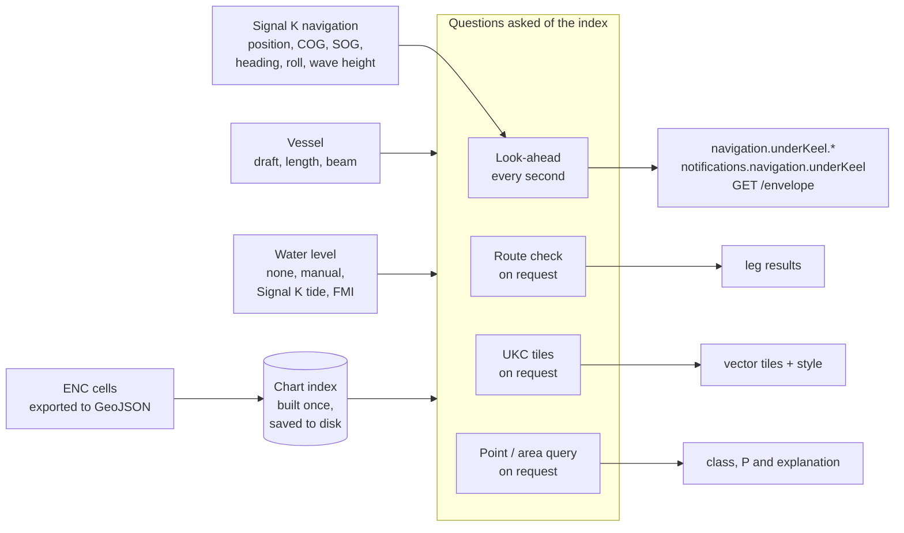

The plugin reads the charts once and keeps a compact depth index. Everything else asks that
index one question: _what is the shallowest charted depth anywhere under this shape, and how
sure is the chart about it?_ The shape is the boat's predicted hull positions for the
look-ahead, a corridor around each leg for a route check, or a map tile for the overlay.

## 3. Setting it up

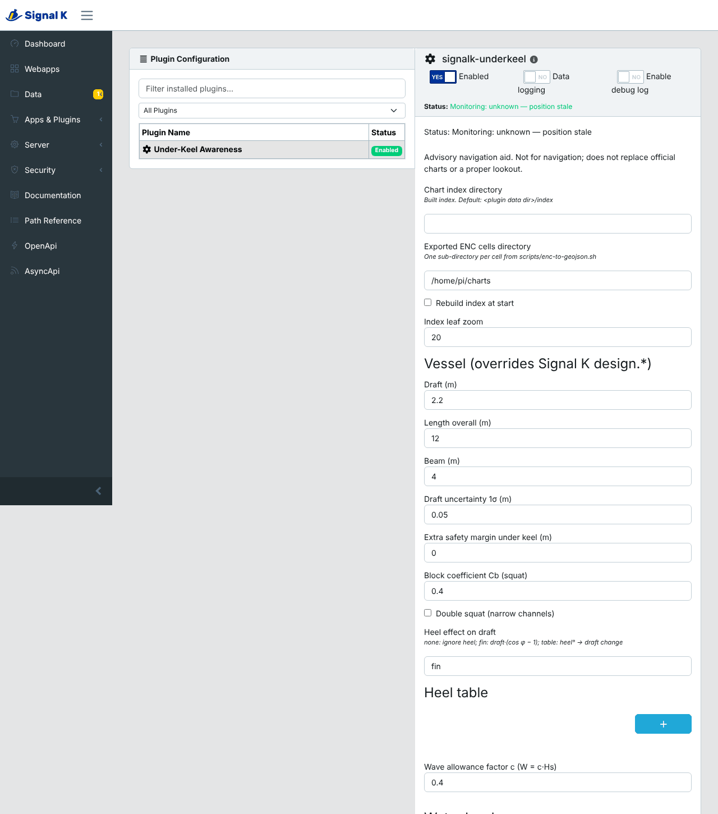

The plugin reads unencrypted S-57 cells that GDAL has exported to GeoJSON, one directory per
cell (the [README](../README.md#chart-data) has the export command), and points
**Exported ENC cells directory** at their parent. The draft comes from **Vessel**, or else from
Signal K `design.draft.maximum`; length and beam fall back to `design.length.overall` and
`design.beam`. Without a draft the engine stays `unknown`. The water level comes from the
source picked under **Water level** (section 8).

The index is built at the first start, in a worker thread so the server keeps running, and
saved under the plugin data directory; until it is ready the engine is `off` with the reason
`building chart index`. Later starts load the saved index (one over 1 MB in the background,
`off` with `loading chart index` meanwhile) unless a cell directory was added or removed or its
`DSID` edition or update changed; then the index is rebuilt and the index reason in `/status` names the cells.
**Rebuild index at start** rebuilds it on every start. An index saved by an older plugin version
whose index format differs is rebuilt too, and so is one whose files cannot be read, as a power
cut during a save can leave them; the reason then names the read error.

The status line at the top of the plugin's page shows the engine state and its reason, for
example `Monitoring: unknown — position stale`.

## 4. From chart cells to a depth index

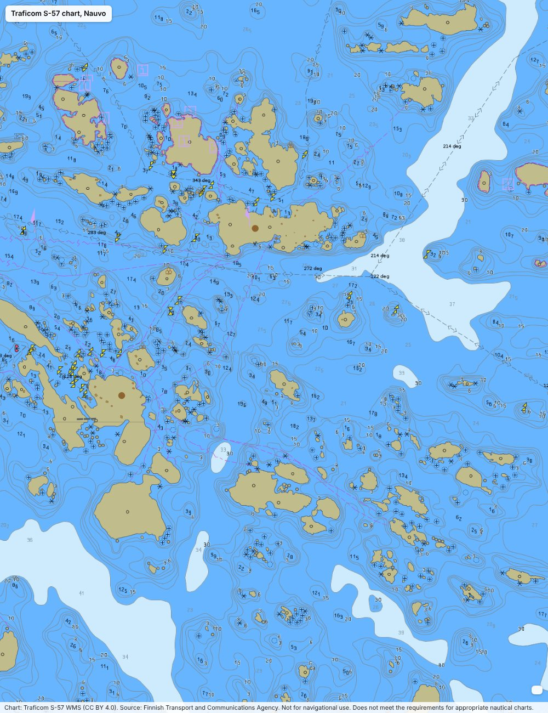

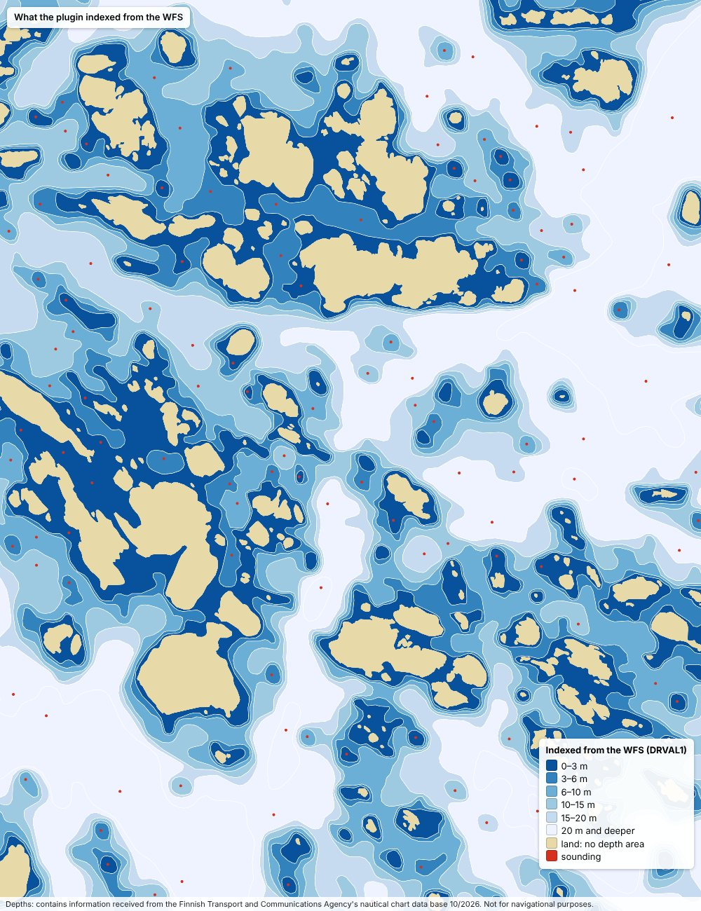

The first picture is the chart; the second is what the plugin indexed for the same box: depth
areas shaded by their shallowest depth (`DRVAL1`), soundings as red dots, and land where no depth
area exists.

### What is read

| S-57 object                  | Used as                                                                          |
| ---------------------------- | -------------------------------------------------------------------------------- |
| `M_COVR` (CATCOV 1)          | where the cell has data; outside every coverage is no data                       |
| `M_QUAL` (`CATZOC`)          | survey quality, which sets the depth and position σ                              |
| `DEPARE`, `DRGARE`           | area depth from `DRVAL1`; missing `DRVAL1` counts as 0 m                         |
| `SWPARE`                     | guaranteed depth, σ 0.1 m unless a shallower hazard inside sets the depth        |
| `SOUNDG`                     | point depths                                                                     |
| `UWTROC`, `WRECKS`, `OBSTRN` | point hazards at `VALSOU`; without it, land when `WATLEV` 1, 2, 4 or 6, else 0 m |
| `LNDARE`, `COALNE`, `SLCONS` | land                                                                             |
| `PONTON`, `FLODOC`, `HULKES` | land                                                                             |
| `UNSARE`                     | no depth: read as a coverage gap, never as water                                 |

Inside a cell's coverage, a place that no depth area, land or unsurveyed area reaches has no
depth either; a sounding's burn disc does not make it water.

Where cells of different usage bands overlap, the larger-scale cell wins and the smaller one
only fills gaps.

### How the index is built

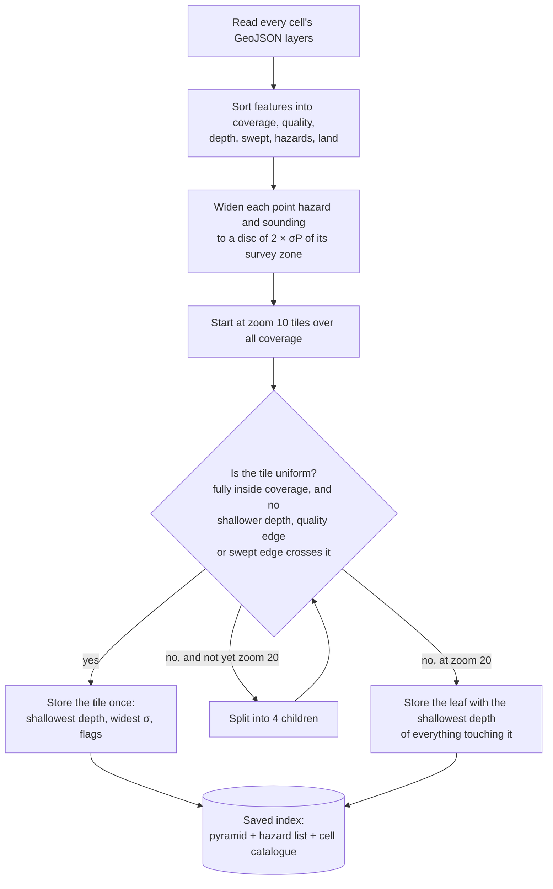

- A tile stores the shallowest depth of anything that touches it, so a query never gets a depth
  deeper than the chart shows anywhere in its shape.
- A point hazard or sounding is burned into a disc of radius 2 × σP, where σP is the position
  uncertainty of the survey zone it sits in. At CATZOC B (±50 m, σP 25 m) that is a disc 50 m in
  radius; at CATZOC C (±500 m, σP 250 m) it is 500 m.
- A leaf zoom of 20 makes the smallest tile about 19 m across at 60° N. The Nauvo box built
  158,784 tiles.
- Each stored tile also carries flags: `NO_COVERAGE`, `UNASSESSED` (no survey quality, or
  CATZOC U), `SWEPT`, `DREDGED`, `NO_DEPTH`.

### Learning from your own soundings

The living chart is off by default. When it is on, the plugin reads the boat's depth sounder
and keeps a running estimate of the depth in each cell of the index, about 76 m across at
60° N:

1. **Quality gate.** A sounding counts only with a satellite fix, HDOP below 2, roll within
   15°, a plausible depth, a position measured within 2 s of the depth and a measured, not
   fallback, water level.
2. **Reduce to chart datum.** The water level at that moment is taken off the measured depth.
3. **Update the cell.** The chart's depth and σ are the starting point; each sounding moves
   the estimate and narrows its σ.
4. **Discrepancy.** After at least 5 soundings on at least 2 separate passes, a cell whose
   estimate is more than 2σ shallower than the chart is marked shallower. Every check then
   uses the shallower depth: look-ahead, route check, query and the UKC overlay. A Signal K
   note marks the place on the chart with the evidence, its depth rounded down to 5 cm; it is
   rewritten at most every 5 minutes as the estimate drops.

Own soundings only ever make the chart shallower. Deeper readings never raise a charted depth,
so a faulty transducer cannot switch off a hazard. The shallower cells survive a change of the
index's leaf zoom: each new cell takes the shallowest depth of the old cells it holds. The
cells are saved to `livechart.json` every 10 minutes, and within 10 s of a cell being marked
shallower; the soundings are appended to `soundings.ndjson` every minute. A state file that
does not load whole is renamed to `livechart.json.bad-<time>` (or `soundings.ndjson.bad-<time>`)
and reported, so it is never saved over. The accepted soundings can be exported as
IHO crowd-sourced bathymetry (CSB) GeoJSON from `GET /livechart/csb.geojson`; nothing is
uploaded anywhere.

### Survey quality to uncertainty

The CATZOC accuracies are read as 95 % bounds, so σ is half the table value. `d` is the
charted depth.

| CATZOC   | Position ± | Depth ±        |
| -------- | ---------- | -------------- |
| A1       | 5 m        | 0.5 m + 1 % d  |
| A2       | 20 m       | 1.0 m + 2 % d  |
| B        | 50 m       | 1.0 m + 2 % d  |
| C        | 500 m      | 2.0 m + 5 % d  |
| D        | 1000 m     | 4.0 m + 10 % d |
| U / none | 1000 m     | 4.0 m + 10 % d |

## 5. How deep is too shallow: the risk number

For each spot the plugin estimates the under-keel clearance (UKC) and how uncertain it is:

```text
UKC = charted depth + water level − draft − heel change − squat − wave allowance − margin
σ²  = σ_chart² + σ_water² + σ_draft² + σ_heel² + σ_squat² + σ_wave²
P(UKC < 0) = Φ(−UKC / σ)          Φ = standard normal distribution
```

| Term           | Source                                                          | σ                     |
| -------------- | --------------------------------------------------------------- | --------------------- |
| charted depth  | the index (section 4)                                           | CATZOC table          |
| water level    | the configured source (section 8)                               | from the source       |
| draft          | configuration or `design.draft.maximum`                         | 0.05 m by default     |
| heel change    | `fin`: draft · (cos φ − 1); `table`: your heel table; `none`: 0 | 0                     |
| squat          | Barrass: Cb · V² / 100 (V in knots), doubled when confined      | 30 % of the squat     |
| wave allowance | 0.4 · significant wave height                                   | 50 % of the allowance |
| margin         | **Extra safety margin under keel**, 0 m by default              | 0                     |

P is the probability that the keel touches. The plugin compares P with three levels:
**alert 1 %**, **warn 5 %**, **alarm 20 %** (configurable under **Look-ahead**).

Worked example: leg 2 of the route in section 10 passes a 3 m depth area at 2.5 m/s.

```text
charted 3 m (±0.53 m) + 0.2 m water level (manual) − draft 2.2 m − squat 0.09 m
  + heel 0 m − wave 0 m → μ = 0.91 m, σ = 0.54 m, P = 4.75 %
```

The mean clearance is 0.91 m. With σ 0.54 m that leaves a 4.75 % chance of touching, which is
above the route check's accepted 1 %. The notification message uses the same sentence, so the
plotter shows which term decides the result.

## 6. Every second: the look-ahead

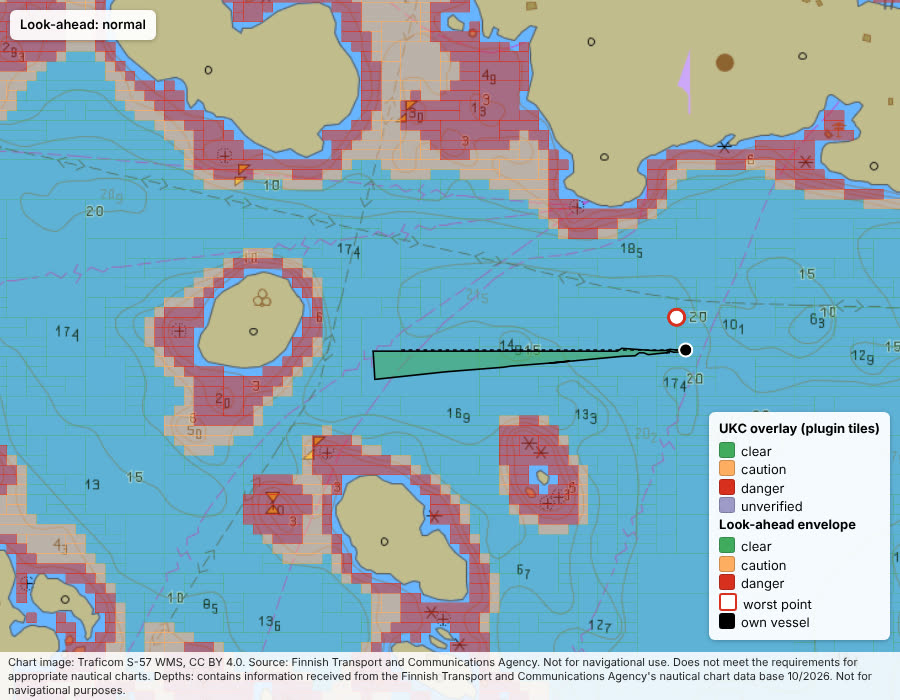

Once a second the plugin predicts where the hull will be over the next minutes and asks the
index about each predicted hull position (a "footprint").

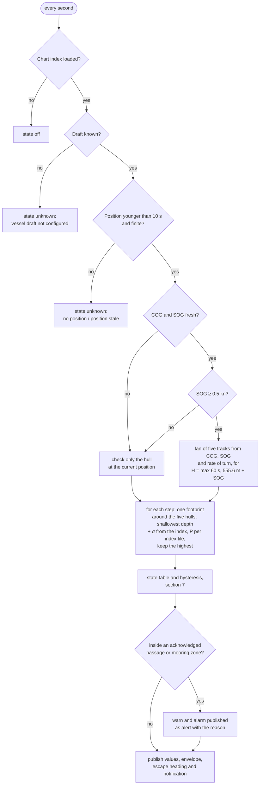

The prediction is a fan of five tracks. The central track keeps the current speed and rate of
turn. The other four add or take 1σ of course (5°) and of rate of turn (0.1°/s), because the
course becomes less certain the further ahead it goes. A turn is held for at most 60 s; after
that the track runs straight.

At each step the plugin places the hull rectangle (length × beam) on each of the five tracks
and joins them into one footprint, the convex hull of the five. The index is asked about that
footprint, so the water between the tracks is checked too. The footprint gets a buffer for
position error, at least 10 m or 2σ of the position uncertainty, and grows fore and aft with
the speed uncertainty. The chart's own position error is added per index tile: a tile counts
2 × σP of its survey zone further out, 50 m at CATZOC B and 500 m at C, so a drying area drawn
60 m off the hull in B water is in reach. Unassessed and Traficom WFS water adds nothing, since
it never reads as `normal` anyway. The position σ comes from the GNSS (HDOP × 3 m, 5 m without HDOP) and
is raised by the integrity check in section 7.

Steps are at most 3 s apart; for a fast boat the step shrinks so neighbouring footprints still
touch. At 5 kn (2.6 m/s) the horizon is 214 s. A tick scores at most 400 footprints: a long
horizon at low speed takes longer steps, up to where neighbouring footprints would stop
touching, and only beyond that is the horizon cut. The look-ahead distance is at most 5 NM
(9260 m) and the minimum horizon at most 600 s.

Below 18 kn the horizon always reaches 555.6 m ahead, so slowing down does not shorten the
envelope. The same distance takes longer, though: 154 s at 7 kn, 270 s at 4 kn. Warn and alarm
count seconds to the shoal, so at lower speed they come closer to it.

The look-ahead uses the higher of speed over ground and speed through water for squat, even
when the course is stale, and the roll of the last 10 s for heel. A `fin`
keel is lifted only by the least roll in that window, since a boat rolling through upright has
its full draft at the bottom of each roll; a `table` keel takes the largest draft change over
the rolls seen. Roll older than 10 s or above 60° counts as no roll: no lift for a `fin` keel,
the largest change in the table for a `table` keel.

## 7. States, alarms and what you see

| State     | When                                                                             | Notification                       |
| --------- | -------------------------------------------------------------------------------- | ---------------------------------- |
| `alarm`   | P ≥ 20 % within 60 s, or mean UKC < 0 within 30 s                                | `alarm`, visual + sound            |
| `warn`    | P ≥ 5 % first reached within 120 s, or part of a footprint has no chart coverage | `warn`, visual + sound             |
| `alert`   | P ≥ 1 % anywhere in the horizon, including a P ≥ 5 % more than 120 s away        | `alert`, visual                    |
| `normal`  | none of the above, with fresh position, course and speed                         | `normal`                           |
| `unknown` | no draft, no or stale position, stale course/speed, non-finite input             | `alert`: "UKC monitoring degraded" |
| `off`     | no chart index, or the plugin is stopped                                         | `alert`, or `normal` when stopped  |

The rows are checked top to bottom; the first match wins. A clean `normal` is then downgraded
when it rests on less than full input:

- course or speed stale: `unknown` ("only the current position is checked");
- water level is a fallback: `alert` with the fallback's reason.

A state is raised after 2 consecutive seconds at its level and lowered after 5 consecutive
seconds below 80 % of its threshold, so a footprint that touches a shoal edge now and then
does not toggle the alarm. Only footprints inside the state's own window count for lowering:
60 s for `alarm`, 120 s for `warn`. `unknown` and `off` apply at once: missing input is never
held as an earlier state. The state before them is remembered, so when input returns it still
takes 5 clear seconds to lower it, and a higher state is taken at once.

### The approach, step by step

The simulated vessel runs west at 5 kn along 60.0814° N toward an island. The envelope is
coloured per footprint class (green clear, amber caution, red danger) over the UKC overlay.

|                                                     |                                                   |
| --------------------------------------------------- | ------------------------------------------------- |
|  | 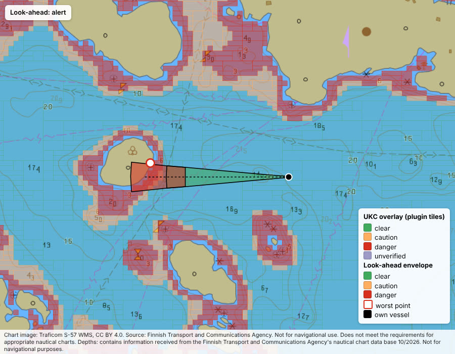 |
| 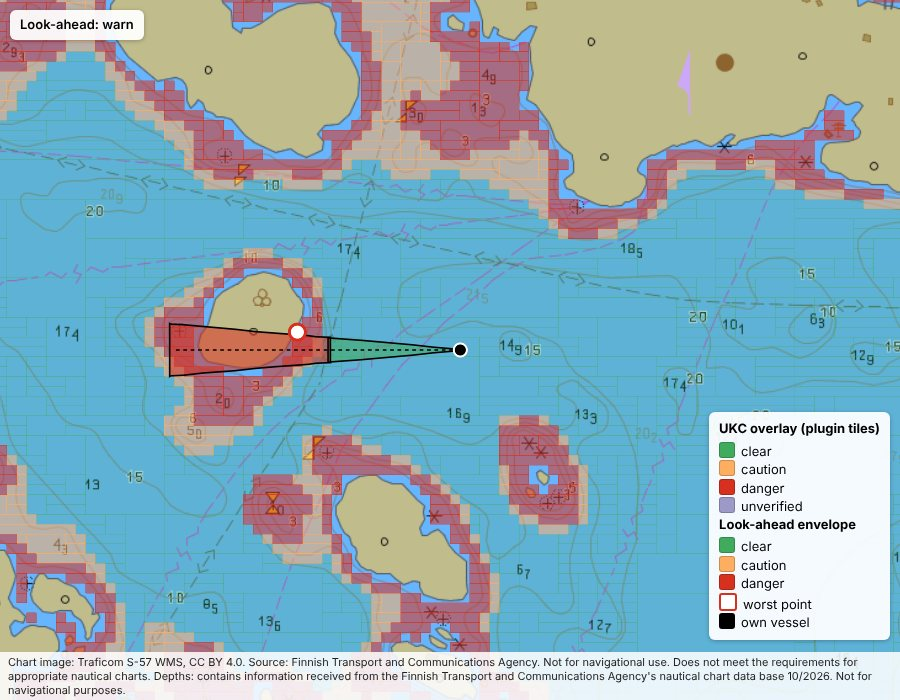     | 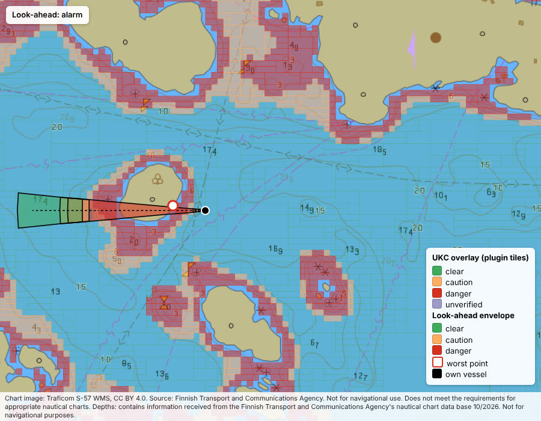 |

| State    | Vessel at | Reason published            | Why                                                           |
| -------- | --------- | --------------------------- | ------------------------------------------------------------- |
| `normal` | 22.0790 E | none                        | no footprint in the 214 s horizon reaches P 1 %               |
| `alert`  | 22.0750 E | `shoal risk ahead in 168 s` | the island is in the horizon, but more than 120 s ahead       |
| `warn`   | 22.0710 E | `shoal ahead in 90 s`       | P ≥ 5 % reached within 120 s                                  |
| `alarm`  | 22.0670 E | `shoal ahead in 18 s`       | P ≥ 20 % within 60 s, and the mean UKC is below 0 within 30 s |

In `alert`, `warn` and `alarm` the deciding point is the island itself, with P > 99 %. What
changes is how soon the boat gets there. The white ring is the centre of the index tile that set
the highest P; in clear water that can be a large tile whose centre lies off the track.

The escape heading published at the same points is 255° in `alert`, 245° in `warn` and 220° in
`alarm`: a turn to port that passes south of the island, growing as the island gets closer.

The thresholds and time windows are set under **Look-ahead**:

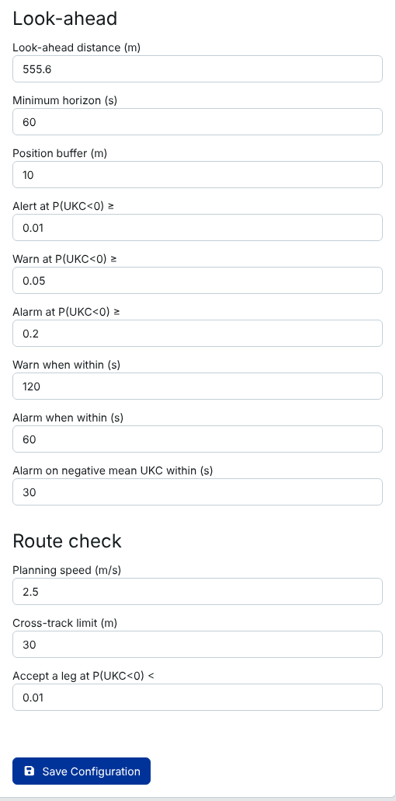

### Signal K values

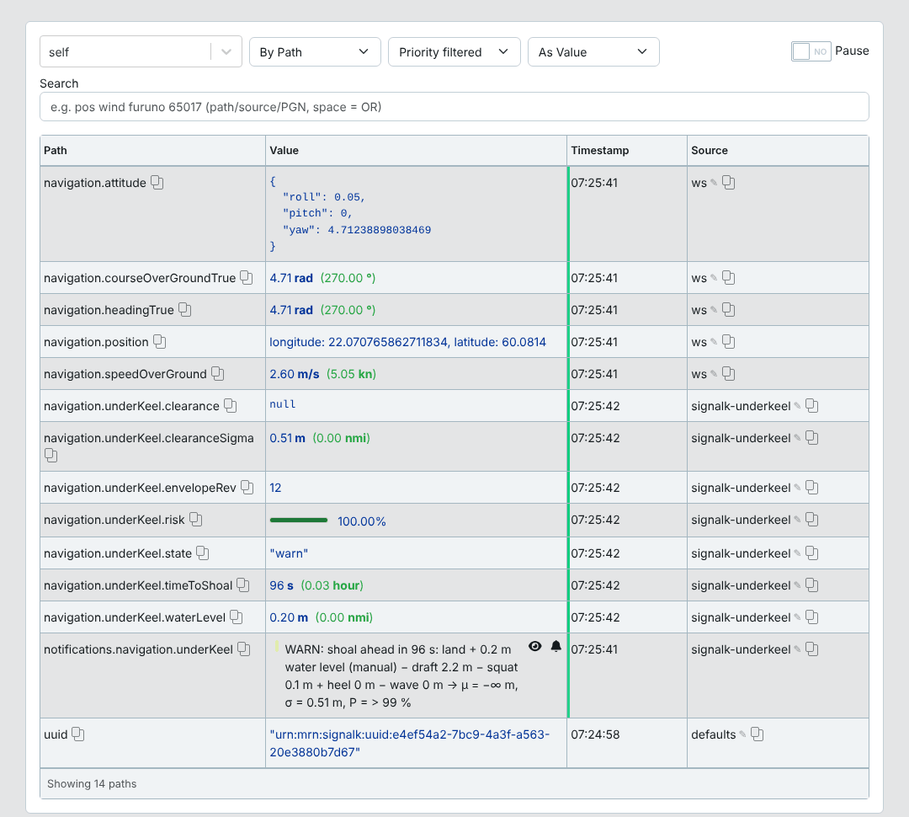

Published every second:

| Path                                         | Unit  | Meaning                                                                                                    |
| -------------------------------------------- | ----- | ---------------------------------------------------------------------------------------------------------- |
| `navigation.underKeel.state`                 |       | `normal`, `alert`, `warn`, `alarm`, `unknown`, `off`                                                       |
| `navigation.underKeel.clearance`             | m     | lowest mean UKC over the horizon                                                                           |
| `navigation.underKeel.clearanceSigma`        | m     | σ of that clearance, from the same footprint                                                               |
| `navigation.underKeel.risk`                  | ratio | highest P(UKC < 0) over the horizon                                                                        |
| `navigation.underKeel.timeToShoal`           | s     | seconds until P first reaches the warn level; null if it does not                                          |
| `navigation.underKeel.escapeHeading`         | rad   | true heading to turn to, below; null in `normal` or no way out                                             |
| `navigation.underKeel.envelopeRev`           |       | increments when `GET /envelope` changes; starts at the start time in ms, so no rev repeats after a restart |
| `navigation.underKeel.waterLevel`            | m     | water level applied above chart datum                                                                      |
| `notifications.navigation.underKeel`         |       | state, message and the explanation of every term                                                           |
| `notifications.navigation.positionIntegrity` |       | GNSS fix doubtful, below                                                                                   |

`clearance` is `null` when nothing is charted, and also when a footprint reaches land, as in the
Data Browser picture: the lowest UKC is then −∞, which JSON cannot carry. `state` and `risk`
still say what is ahead.

When the plugin stops it publishes `state` `off` and every other `navigation.underKeel` value as
`null`, so no reading outlives the monitoring.

The notification is sent only when its state or message changes. Its `data.explanation`
carries each term of the sentence as a number, plus the deciding chart cell and its edition,
and the named hazard when one set the depth. The `alarm` from the approach:

```json
{
  "state": "alarm",
  "method": ["visual", "sound"],
  "message": "shoal ahead in 18 s: land + 0.2 m water level (manual) − draft 2.2 m − squat 0.1 m + heel 0 m − wave 0 m → μ = −∞ m, σ = 0.51 m, P = > 99 %",
  "data": {
    "engineState": "alarm",
    "clearance": null,
    "clearanceSigma": 0.51,
    "risk": 1,
    "timeToShoal": 18,
    "explanation": {
      "charted": null,
      "sigmaCharted": 0.5,
      "flags": [],
      "cell": { "name": "FI4WFS01", "edition": 1, "update": 0 },
      "waterLevel": 0.2,
      "sigmaWaterLevel": 0.1,
      "waterLevelSource": "manual",
      "draft": 2.2,
      "heel": 0,
      "squat": 0.1,
      "wave": 0,
      "margin": 0,
      "mean": null,
      "sigma": 0.51,
      "risk": 1
    }
  }
}
```

`clearanceSigma` is rounded here. The server adds `id` and `status` for acknowledging and
silencing.

### Escape heading

In `alert`, `warn` and `alarm` the plugin also looks for a way out. It tries headings in 5°
steps out to 90° either side, smallest change first, each reached by a turn at the boat's
maximum rate of turn (3°/s by default). The first heading that stays clear over the whole
horizon wins; if none does, the one with the most time before shoal water. The footprint at
the vessel is the same on every heading and is not counted. When every heading reaches shoal
water at the same time, or within the first step, the escape heading is null: there is no
heading to recommend. The result is published as `navigation.underKeel.escapeHeading`. It is
searched at most every 3 s and held in between. The plugin only publishes it; it never steers.

### Position integrity

The look-ahead is only as good as the position. Each second the plugin compares the GNSS fix
with a dead-reckoning track from heading, speed through water and a current learned while the
boat holds its course. When the fix moves further from that track than their combined
uncertainty allows, as when GNSS is jammed or spoofed:

- the position σ is raised to the distance between them, so every footprint grows;
- `notifications.navigation.positionIntegrity` is raised as `warn` with the reason.

A fix that is not a satellite fix sets the position σ to at least 50 m, and an HDOP above 4 is
reported the same way. Without speed through water the check cannot run; the notification and
`/status` say so.

### Acknowledged passages and mooring zones

Some places alarm every time and are known to be fine, such as a narrow channel the skipper
uses daily. `POST /acks` records an acknowledgement for the current situation:

- the area of the current look-ahead footprints, or a polygon given in the request;
- a heading sector, ±20° by default;
- the current water level and draft;
- an optional expiry.

Later, while the footprint is inside that area, the heading inside the sector, the water level
no more than 5 cm lower and the draft no deeper, `warn` and `alarm` are published as `alert`
with the reason "acknowledged passage". They are never published as `normal`. A negative mean
UKC within 30 s is never suppressed: an acknowledgement covers an uncertain chart, not a charted
depth shallower than the keel. While the water level is a fallback (a stale or missing feed) no
acknowledgement applies and `POST /acks` answers 409: whatever its value, the fallback is a
guess, not a measured level to compare with the acknowledged one. `GET /acks` lists them;
`POST` and `DELETE /acks/:id` need read-write access.

Mooring zones work the same way without a heading or water-level condition. They are Signal K
regions named in the settings, for example the home berth; inside one, `warn` and `alarm` are
published as `alert` with the zone's name. A hole in the region, such as water cut out around a
rock, is not part of the zone: a footprint reaching into a hole is not suppressed.

### Grounding detector

The optional grounding detector, off by default, is the only part of the plugin that writes
`notifications.grounding`, the Signal K emergency that means "aground". It fires when all of
these hold:

- SOG falls by more than 70 % within 5 s, from at least 0.5 m/s;
- there was no gear change in the last 10 s;
- the measured depth is within 0.3 m of the draft, or the look-ahead puts P ≥ 80 % under the
  boat;
- when an acceleration path is configured, a deceleration of at least 2 m/s² in the last 5 s.

It holds until SOG stays above 0.5 m/s for 10 s.

## 8. Water level

| Source         | What it reads                                                                                                                         | σ                                                         |
| -------------- | ------------------------------------------------------------------------------------------------------------------------------------- | --------------------------------------------------------- |
| `none`         | chart datum (0 m)                                                                                                                     | 0.3 m                                                     |
| `manual`       | the height you enter above chart datum                                                                                                | the σ you enter                                           |
| `signalk-tide` | `environment.tide.heightNow`; from 5 min after the reading the lower of it and `heightLow`, until 6 h past `timeLow` (or the reading) | the σ you enter                                           |
| `fmi`          | Finnish Meteorological Institute sea-level forecast, anchored to the nearest gauge                                                    | grows with lead time and gauge distance, plus the datum σ |

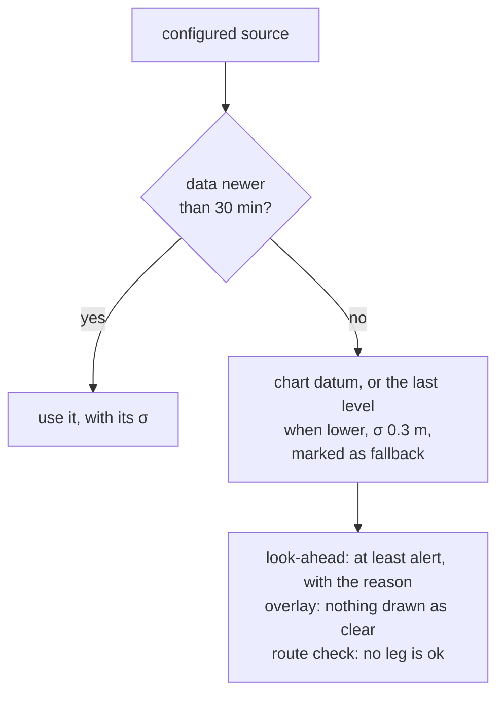

FMI reports above theoretical mean water and above N2000. Each cell's S-57 vertical datum
(`VERDAT`) is mapped to one of them: codes 3, 19 and 26 map to mean water by default, cells on
N2000 need an entry under **Chart datum mappings**, and an unmapped datum is matched with
σ 0.5 m. A cell whose `M_SDAT` or `M_VDAT` areas use another `VERDAT` than its `DSID` is
matched as unknown too, with those codes listed as `datumAreas`. The plugin fetches FMI every
600 s by default, after the vessel moves 10 km from the forecast point, and each minute from
when the held forecast is 25 minutes old until a fetch succeeds; the 1 Hz loop never waits on
the network.

`GET /plugins/signalk-underkeel/v1/status` shows the source, the level applied, the source's
health and the datum mapping per cell.

## 9. The UKC overlay

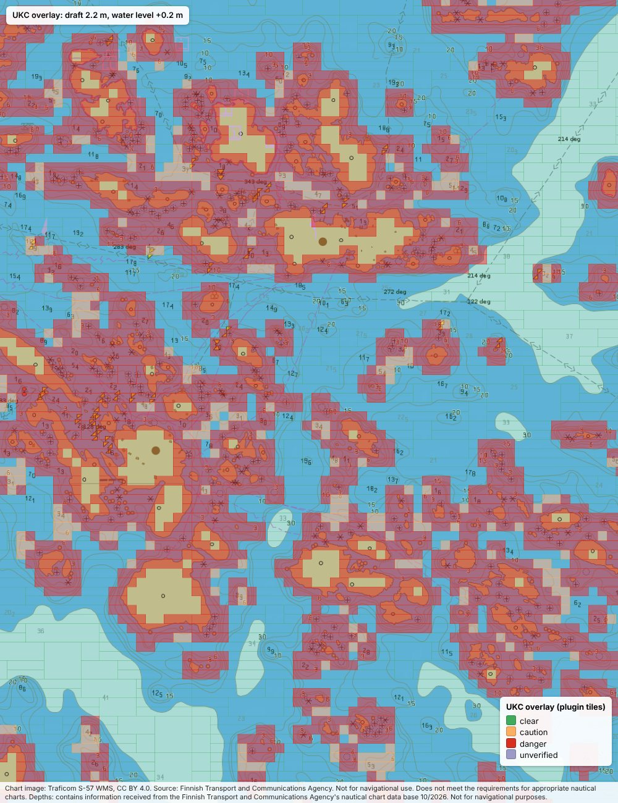

`GET /plugins/signalk-underkeel/v1/tiles/ukc/{z}/{x}/{y}.pbf` serves vector tiles from zoom 11,
one layer `ukc`, every index cell classed for the current draft and water level at zero speed
(no squat):

| Class        | Colour | Rule                                                             |
| ------------ | ------ | ---------------------------------------------------------------- |
| `danger`     | red    | P ≥ warn level (5 %)                                             |
| `unverified` | purple | no coverage, unassessed survey or no depth data                  |
| `caution`    | amber  | P ≥ alert level (1 %)                                            |
| `clear`      | green  | everything else; never drawn while the water level is a fallback |
| `land`       | none   | left to the chart                                                |

A cell is also drawn at least as bad as any cell whose chart position error reaches it: 2 × σP
of that cell's assessed survey, 50 m at CATZOC B and 500 m at C, the reach a route check and
`POST /query` count. Water 60 m from a drying area in B water is therefore `danger`, not
`clear`; unassessed and Traficom WFS water adds no reach and is `unverified` anyway.

The style draws `clear` at 25 % opacity and the other classes at 55 %, so over the chart's blue
water `danger` looks purple-red and `caution` looks grey-tan.

A tile's classes stay the same while the threshold depth moves within a range: each cell
changes class only where its P crosses the alert or warn level. The plugin records that range
for every tile it serves, and `GET /tiles/ukc/changes` lists the tiles whose range the current
water level, draft and wave allowance have left, or in which an own sounding changed a cell.
The background runtime asks every 15 s and after each 1 cm water-level move, and Freeboard
fetches only the tiles listed. With the tide rising 2 mm/s that is 2 tile fetches a minute in
a z14 view instead of 108.

`GET /ukc-style.json` is a MapLibre style for these tiles. The plugin also registers a
`plotterExtensions` resource that declares the overlay, so a plotter that supports the Plotter
Extensions API can offer it as a layer.

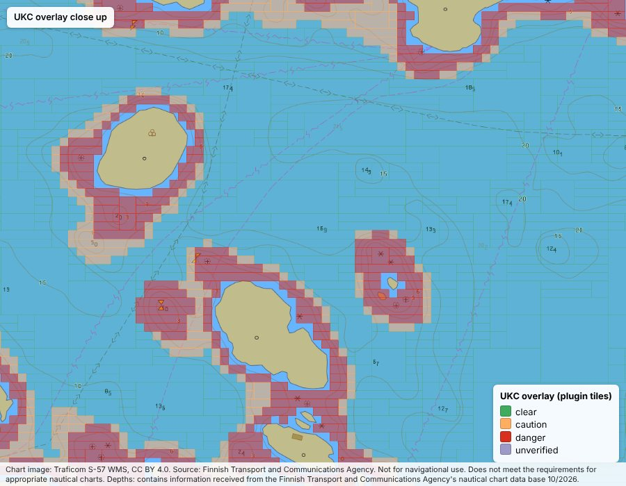

Closer in, each drawn cell is one index leaf:

- `danger` rings the islands where the depth areas start at 0 m;
- `caution` follows the 3 m depth areas: mean UKC 1.0 m at zero speed, σ 0.54 m, P about 3 %;
- 6 m and deeper water is `clear`;
- the chart's land and the leaves the index counts as land are left undrawn. Where the WFS
  depth areas stop short of the WMS shoreline, that strip is land to the plugin, so blue chart
  water shows through without an overlay colour.

Where a map tile is drawn coarser than the index, as in the first picture, each drawn cell
takes the shallowest depth and widest σ of the index cells under it. A coarse cell that holds
both land and water is therefore `danger`, and the overlay never shows a cell safer than any
part of it.

## 10. Checking a route

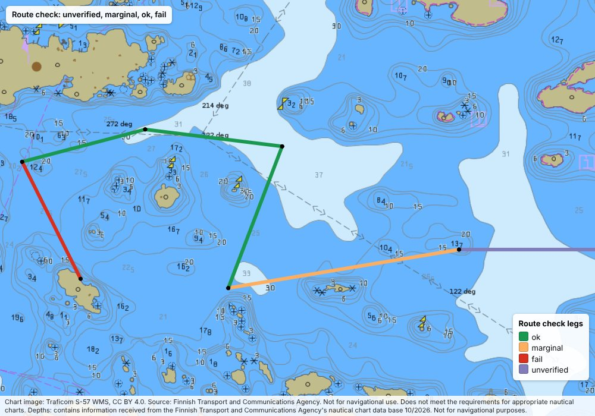

A route check takes a route, either as geometry or as a Signal K route resource, and checks
each leg at the time the boat would be on it. The request fields are listed in the
[README](../README.md).

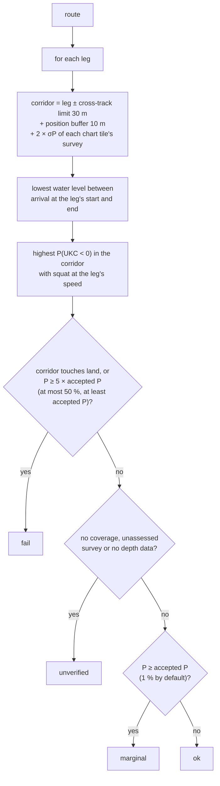

The corridor follows the leg as the chart draws it, the rhumb line, and on a long leg also
the great circle a course computer may steer instead. A fallback water level then turns an `ok`
leg into `unverified`. The route in the picture runs
from east to west at 2.5 m/s:

| Leg | Status       | P(UKC < 0) | Shallowest charted | Why                                              |
| --- | ------------ | ---------- | ------------------ | ------------------------------------------------ |
| 1   | `unverified` | 0          | 10 m               | starts east of 22.15° E, outside the indexed box |
| 2   | `marginal`   | 0.0475     | 3 m                | passes a 3 m depth area (section 5)              |
| 3   | `ok`         | 0          | 10 m               | open water                                       |
| 4   | `ok`         | 0          | 15 m               | open water                                       |
| 5   | `ok`         | 0          | 6 m                | past a 6 m depth area, mean UKC 3.91 m           |
| 6   | `fail`       | 1          | land               | the corridor crosses an island                   |

Each leg also returns its length, ETA at both ends, minimum UKC, σ, flags, the deciding position
and hazard, the explanation, and the response lists the cell editions used.

### Suggesting a way round

`POST /route-repair` takes the same body as the route check. For every leg that is `fail` or
`marginal`, it searches for a path around the shoal:

1. A grid of cells is laid around the leg, reaching half the leg's length beyond it on every
   side, and at least 300 m. A cell is blocked when its corridor would fail, or when it touches
   water the plugin cannot check: no coverage, unassessed survey or no depth. A repair never
   routes through unchecked water.
2. The cheapest any-angle path through the open cells is found. Water with a higher grounding
   probability costs more, so the path keeps away from the margin.
3. Waypoints are dropped wherever the straight line between their neighbours still passes the
   check, so the result has as few turns as it can.

The answer lists the waypoints to insert into each failing leg and the legs they make, checked
like any route. Legs are repaired in order, each checked at the time the detours before it bring
the boat there, and the answer also holds the whole route with every waypoint inserted, checked
again, so a leg a detour makes late shows its status at the new time. It never moves an existing point. When no path is found, the leg says why and
gets no waypoints. One request repairs a bounded number of legs, and any further ones are
listed as not searched; the limits are in [plan §4.11](DEVELOPMENT-PLAN.md). A plotter shows
the answer as a suggestion; the skipper decides whether to use it.

### Choosing when to leave

`POST /departure-window` also takes the route-check body, plus a horizon and a step: by default
every 15 minutes over the next 48 hours. It checks the route for each departure with the water
level the forecast gives for the time each leg is sailed, up to one step later so a departure
between two samples is covered too, and returns the intervals in which
every leg is `ok`, with the worst status of each departure. A leg is checked again only when
its water level changes; a leg that passed at one level is not checked again at a higher one,
nor a leg that failed at a lower one, since more water never makes a leg worse. A window over a long route or one of many legs is refused when it
would cost one request too much work; a longer step or a shorter horizon fits it. The limits
are in [plan §4.11](DEVELOPMENT-PLAN.md). In Finnish waters this matters during low-water spells; in tidal waters it works as a tide-gate
planner.

## 11. Asking about one spot

The query endpoint answers the same question for one point or area at the current water level,
using the draft in the request when one is given and the configured vessel draft otherwise: the class, P(UKC < 0), the deciding hazard, the explanation and the same sentence
as the notification. A plotter can use it for a cursor readout.

## 12. Traficom WFS depths (optional)

With **Traficom WFS depths** enabled, the plugin downloads Traficom's INSPIRE WFS depth areas
and soundings for a box around the vessel and adds them to the index as one more cell. **The
data is not for navigational purposes**: Traficom licenses it for non-navigational use only.

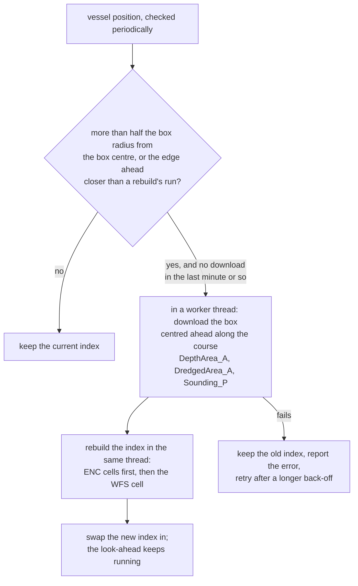

- **Box:** radius 10 km by default (2–25 km). With the default, a new box is fetched once the
  vessel is 5 km from the centre, or earlier at speed: once the edge ahead is closer than 1.5
  times the distance the vessel covered during the last download and rebuild, plus the
  look-ahead distance. The new box is centred where the vessel will be when it is ready, at
  most 8 km ahead, so a slow Raspberry Pi at planing speed is not left at the old box's edge.
- **Priority:** the WFS cell is usage band 1, so any ENC cell wins where both cover.
- **Land:** the WFS has no land objects. Water that no depth area reaches is land, so a gap in
  the data never reads as open water.
- **Survey quality:** the WFS has none. The plugin assumes the CATZOC set under **Survey quality
  to assume** (default B). It sets each sounding's danger radius: B 50 m, C 500 m, U 1000 m.
- **Rocks, wrecks and obstructions** are not in the WFS, so they are missing wherever it is the
  only source.
- **Never safe:** every index cell from the WFS carries `NOT_FOR_NAVIGATION`. Where the
  look-ahead would otherwise say `normal`, it says `alert` with the reason "depths from the
  Traficom WFS: not for navigational purposes; no rocks, wrecks or survey quality". Route legs
  over it are `unverified`, and the overlay draws it `unverified`, never `clear`. Warnings and
  alarms over WFS water are raised as usual.
- **Status:** `GET /status` has a `wfs` section with the box, its fetch time, the feature counts
  and the notice; the plugin status line repeats the notice while the source is on.

## 13. In Freeboard

The plugin serves its own Freeboard UI through the Plotter Extensions API, so Freeboard itself
needs no change. The screenshots use a Freeboard-SK 3.4.0-beta.1 build with the Traficom WMS
chart, on the route from the Nauvo fairway west to Stenskär harbour at 7 kn, with a 1.8 m draft.

| Where in Freeboard                     | What the plugin adds                                                                                                                                        |
| -------------------------------------- | ----------------------------------------------------------------------------------------------------------------------------------------------------------- |
| Layers → Charts → Plugin layers        | Under-keel look-ahead (on), Under-keel route check (on), Under-keel risk (off)                                                                              |
| Widget grid                            | Under-keel status: state colour, minimum clearance, time to shoal and the reason                                                                            |
| Toolbar button (boat icon), the widget | Under-keel details panel: state, water level, and a leg table per route on the chart                                                                        |
| Hidden background page                 | refetches the envelope on each new revision (every 3 s without a Signal K stream) and checks the routes on the chart 1 s after each change and every minute |

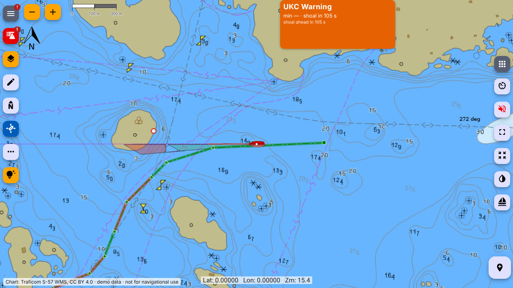

_Heading west at 7 kn, the envelope reaches the islet ahead and is coloured by state, here
warn. The widget at the top shows the state, the minimum clearance and the time to shoal. The
route legs are coloured by the route check._

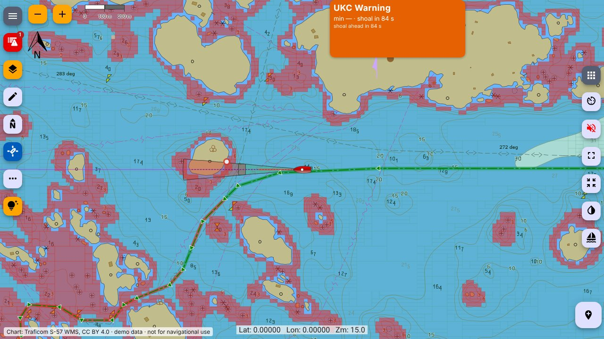

_Under-keel risk is off by default. Ticked in the chart list, it draws the UKC tiles of §9 over
the chart._

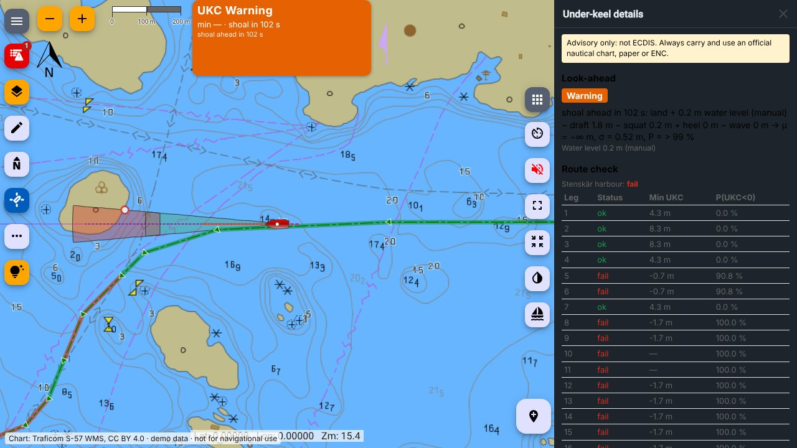

_The details panel lists every leg of each route on the chart. Legs 5 and 6 fail on a 1 m
sounding about 60 m off the track: its 50 m survey-category-B position uncertainty reaches the
10 m cross-track corridor. The legs west of the fairway fail because the open data has a
0–3 m depth area in the channel, which counts as 0 m._

The widget and the panel use Freeboard's depth unit. On a host that lacks a capability, the
page says what is missing: no Signal K stream on the widget, or no shared routes in the panel.

## 14. What the plugin never does

- It never reports `normal` on stale position, missing draft, missing index, missing chart
  coverage or a fallback water level. Each gives `unknown`, `off`, `warn` or `alert` with a
  reason.
- It never marks a route leg `ok` when the corridor lacks coverage or survey quality; such legs
  are `unverified`.
- It never sends autopilot or steering commands.
- Only the optional grounding detector writes `notifications.grounding`; look-ahead warnings
  use `notifications.navigation.underKeel`.
- An acknowledged passage or a mooring zone never turns a warning into `normal`.
- Its own soundings never make the chart deeper, and it never uploads them.
- A suggested repair never moves an existing route point and never routes through unchecked
  water.

## 15. Known limits

- The index resolves about 19 m at 60° N. A leaf that touches land counts as land, so up to one
  leaf width of water along a shore is drawn as land or danger.
- Burn discs are as wide as the survey's position uncertainty: a CATZOC C sounding blocks a
  disc 1 km across, and since each C tile also counts 500 m beyond a footprint, the sounding
  reaches a footprint up to 1 km away.
- An index leaf that straddles two survey zones takes the worse zone's σ when the zones share
  their boundary vertex for vertex. A boundary split differently on each side, an overlap or a
  gap leaves the leaf unassessed. The same holds for two cells of one usage band meeting along
  a shared edge: matched vertex for vertex, the leaf on the edge is covered; otherwise it reads
  as no coverage.
- Only unencrypted S-57 cells exported with `scripts/enc-to-geojson.sh` are read.
- The look-ahead follows course and turn rate, not the route. In a winding fairway it sees the
  shore ahead before each bend and raises warn or alarm until the boat turns.
- Freeboard shows the envelope and leg colours through the Plotter Extensions API. It cannot
  colour legs while they are dragged in its route editor; the check runs 1 s after the change.
  Other plotters get the same data as GeoJSON and vector tiles.
